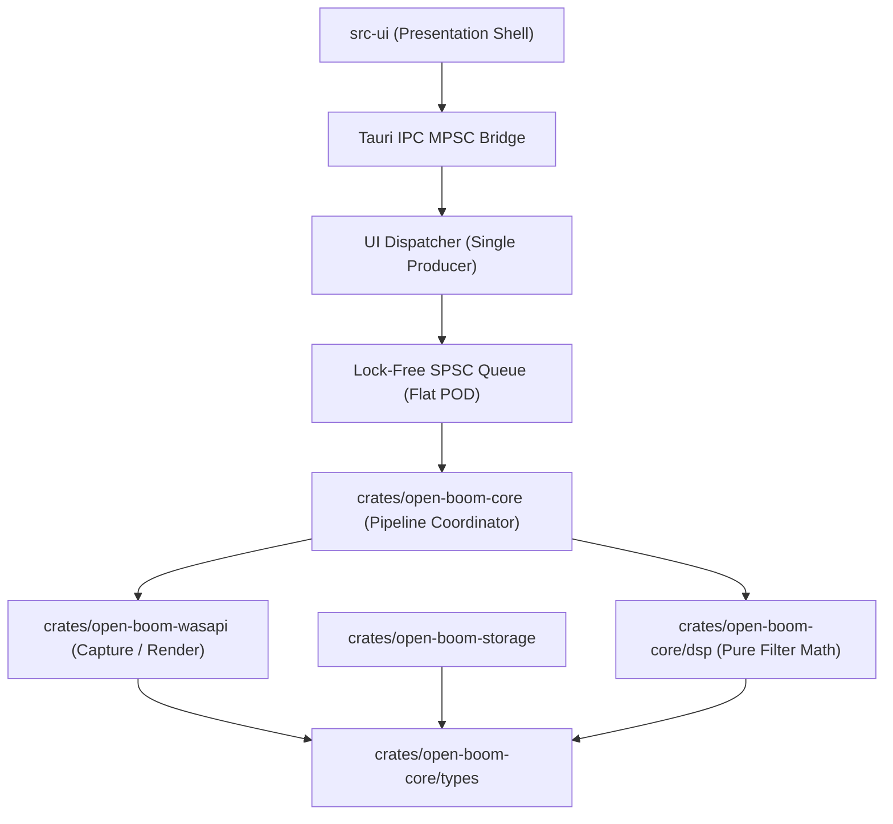
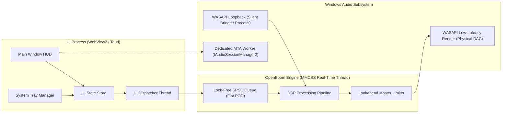
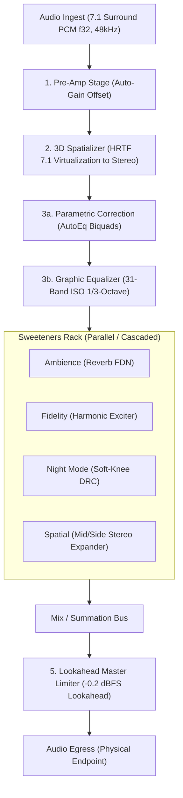

# Architecture Spine — OpenBoom

## Design Paradigm

OpenBoom follows a **Pipes-and-Filters with Hexagonal Decoupling** paradigm. The real-time audio domain is strictly partitioned from the UI and OS management planes:

```
+-------------------------------------------------------------------------------+
|                       UI Presentation & Control Plane                         |
|      (Desktop Shell: Fluent Dark HUD, Dial 3D, Sliders, Preset Browser)       |
+-------------------------------------------------------------------------------+
                                  |         ^
   Tauri MPSC Async Commands      |         | Telemetry / Meters (Atomics)
                                  v         |
+-------------------------------------------------------------------------------+
|             UI Dispatcher Thread -> Lock-Free Command Queue (SPSC)            |
|                     (Flat POD Enums #[repr(C)], Zero Heap)                     |
+-------------------------------------------------------------------------------+
                                  |
                                  v
+-------------------------------------------------------------------------------+
|                     Real-Time Audio DSP Engine Core                           |
|  [Ingestion Adapter] -> [Pipes-and-Filters DSP Chain] -> [Render Adapter]    |
|   - Virtual Loopback     1. Preamp Stage (Auto-Gain Offset) - WASAPI Low-Lat  |
|   - Process Loopback     2. 3D Spatializer (7.1 to Stereo)   - MMCSS Pro Audio|
|   - 48kHz Resampler      3. Dual EQ: Parametric + 31-Band                     |
|                          4. Sweeteners (Ambience/Fidelity/Night/Spatial)      |
|                          5. Master Lookahead Peak Limiter (-0.2 dBFS)         |
+-------------------------------------------------------------------------------+
                                  |
                                  v
+-------------------------------------------------------------------------------+
|                         Secondary Adapters & Storage                          |
|   - MMDeviceAPI / IAudioSessionManager2 (MTA Dedicated Worker Thread)         |
|   - Offline AutoEq Index (Read-Only Packed Database, In-Memory Lookups)       |
|   - Local JSON Persistence (%APPDATA%/OpenBoom/ Presets & Settings)           |
+-------------------------------------------------------------------------------+
```

### Layer to Directory Mapping
* `crates/open-boom-core/src/dsp/`: Pure mathematical DSP filter units (no OS APIs, no heap allocations during streaming, SIMD vectorization).
* `crates/open-boom-core/src/engine/`: Pipeline coordinator, buffer scheduling, lock-free SPSC ring buffers, and parameter interpolation.
* `crates/open-boom-wasapi/src/`: OS audio boundary (WASAPI Process Loopback, Render client, MMDeviceAPI session manager).
* `crates/open-boom-storage/src/`: Bundled AutoEq database index and atomic JSON preset persistence.
* `src-tauri/src/`: Desktop application shell, IPC dispatcher bridge, and system tray management.
* `src-ui/src/`: User interface presentation, Dark Fluent components, Webview2 bridge, and state store.

## Invariants & Rules

### Dependency Direction



* Downward dependency only: `src-ui` depends on command contracts, never on internal audio pointers.
* `crates/open-boom-core/src/dsp` has zero dependencies on Windows OS headers or I/O frameworks; it is pure signal processing math.

---

### AD-1 — Real-Time Audio Thread Invariants & Lock-Free POD Boundary

- **Binds:** `audio_engine`, `dsp_pipeline`, `all_dsp_modules`
- **Prevents:** Priority inversion, Garbage Collection pauses, thread contention, and audio dropouts/crackling.
- **Rule:** The audio processing thread executes under Windows MMCSS (`Pro Audio` profile via `AvSetMmThreadCharacteristicsW`). Inside the real-time audio callback loop, code is strictly forbidden from:
  1. Invoking heap allocations (`malloc`, `new`, vector reallocations, string parsing).
  2. Acquiring blocking synchronization primitives (`Mutex`, `CRITICAL_SECTION`, monitor locks, condition variables).
  3. Performing file, socket, or console I/O and synchronous logging.
  All communication from the UI to the audio thread must pass through a single-producer single-consumer (SPSC) lock-free ring buffer transferring fixed-size, flat `#[repr(C)]` Plain Old Data (POD) command structs (`AudioCommand` enum). Deserializing JSON strings or dynamic envelopes inside the audio thread is strictly prohibited. Multi-threaded Tauri async handlers push commands to a dedicated UI Dispatcher channel that serializes pushes into the single-producer ring buffer.

---

### AD-2 — Driverless Audio Loopback Capture & Slapback Echo Prevention

- **Binds:** `audio_capture`, `stream_router`, `device_io`
- **Prevents:** Acoustic feedback slapback echo (hearing raw direct audio plus delayed processed audio simultaneously), kernel driver installation (`.sys`), WHQL signing expenses, and system BSOD crashes.
- **Rule:** To eliminate slapback echo in user-mode without kernel drivers, OpenBoom implements a dual-mode isolation routing strategy:
  1. **Mode A (Default Loopback Bridge Ingress):** A virtual loopback device bridge is configured as the default Windows playback endpoint. System applications render silently into this bridge. OpenBoom captures from the bridge via WASAPI, processes the stream, and renders exclusively to the physical audio endpoint (Headphones/DAC).
  2. **Mode B (Driverless Process Loopback & Session Muting):** On Windows 10 (build 19041+) and Windows 11 (build 22000+), audio capture can use `AUDIOCLIENT_PROCESS_LOOPBACK_PARAMS` with `PROCESS_LOOPBACK_MODE_EXCLUDE_PROCESS_TREE` (excluding OpenBoom's PID). When active on a physical endpoint, OpenBoom programmatically attenuates the captured application's master endpoint session volume via Core Audio `ISimpleAudioVolume` (capturing the unattenuated stream), preventing double-playback through the DAC. `[ASSUMPTION: Process Loopback Primary]`

---

### AD-3 — Unified 48 kHz Float32 Pipeline & Channel Layout Contract

- **Binds:** `audio_engine`, `dsp_pipeline`, all filter modules
- **Prevents:** Sample rate drift, intermediate quantization noise, clipping between filters, and buffer stride mismatches across DSP stages.
- **Rule:** All internal DSP stages process continuous 32-bit floating point PCM (`f32`) normalized to `[-1.0, +1.0]` at a fixed internal rate of 48,000 Hz. The channel layout contract across stages is strictly fixed:
  1. **Stage 1 (Ingress & Preamp):** Normalizes captured audio to 7.1 surround (8 channels). Stereo inputs are mapped to Front Left and Front Right.
  2. **Stage 2 (3D Spatializer):** Folds 8 channels (7.1 virtual speakers) down to 2 channels (Binaural Stereo) via HRTF convolution.
  3. **Stages 3 to 5 (Dual EQ, Sweeteners Rack, Master Limiter):** Process invariant 2-channel stereo (`[L, R]`).
  Sample rate conversion (for 44.1 kHz, 96 kHz, 192 kHz streams) occurs strictly at the capture ingress boundary.

---

### AD-4 — Single Source of Truth for State & Block-Based Parameter Smoothing

- **Binds:** `ui_controller`, `state_manager`, `dsp_pipeline`
- **Prevents:** Parameter race conditions, zipper noise clicks, filter pole blowups outside the unit circle, and SPSC queue overflows.
- **Rule:** The UI state store maintains presentation state and emits immutable command messages. To ensure stability and prevent filter explosions:
  1. Presets and multi-band settings must be transmitted as atomic snapshots (e.g. `LoadEqSnapshot { gains_db: [f32; 31], preamp_offset_db: f32 }`), guaranteeing atomic application in a single queue pop.
  2. Gain and sweetener adjustments apply linear interpolation across samples.
  3. Biquad filter coefficients are recalculated at sub-buffer block boundaries (every 32 or 64 samples) using Direct Form II Transposed topology with smoothed target gain, never sample-by-sample, preventing poles from exiting the unit circle.

---

### AD-5 — Mandatory Master Lookahead Peak Limiter & Phase-Continuous Bypass

- **Binds:** `dsp_pipeline`, `master_limiter`
- **Prevents:** Hearing damage, digital clipping (0 dBFS overflow), and transient DC pops or time-slip glitches during A/B comparison.
- **Rule:** The Master Peak Limiter is the mandatory terminal stage of the DSP pipeline before output rendering. It operates with a 2ms lookahead buffer and fast transparent release, clamping true output peaks at -0.2 dBFS; it cannot be disabled by user presets. The instant A/B Bypass routes audio around filter stages (Preamp, Spatializer, Dual EQ, Sweeteners) while retaining the 2ms lookahead delay buffer and master limiter, cross-fading over 5ms to guarantee seamless phase continuity without audible clicks or latency jumps.

---

### AD-6 — Decoupled Dual-Stage Equalization (AutoEq Parametric + 31-Band Graphic)

- **Binds:** `autoeq_engine`, `eq_stage`, `preamp_stage`
- **Prevents:** Data shape clashes between arbitrary AutoEq parametric curves and fixed 31-band graphic filters, and digital clipping from positive gain boosts.
- **Rule:** Equalization is architecturally split into two distinct, sequential stages:
  1. **Parametric Correction Stage:** Evaluates up to 12 arbitrary second-order IIR biquad filters loaded from AutoEq profiles (variable center frequency, Q, and gain).
  2. **Graphic EQ Stage:** Evaluates a fixed 31-band bank adhering to ISO 1/3-octave center frequencies (20 Hz to 20 kHz) with constant Q (4.31).
  Whenever an active AutoEq profile or graphic preset introduces positive gain (positive peak gain > 0 dB), the UI Control Store deterministically calculates an equal negative digital attenuation offset (`preamp_offset_db = -max_positive_gain_db`) and transmits it as part of the atomic EQ snapshot.

---

### AD-7 — Modular Core-Engine and UI Shell Architecture

- **Binds:** `project_structure`, `build_system`, `packaging`
- **Prevents:** Monolithic lock-in between UI framework and the low-latency audio core, and runtime memory inflation exceeding the 40 MB budget.
- **Rule:** The application is partitioned into two distinct artifacts:
  1. `crates/open-boom-core`: A high-performance native Rust engine managing WASAPI I/O and SIMD DSP, exportable as a clean C-ABI dynamic library.
  2. `src-tauri` / `src-ui`: A lightweight desktop shell utilizing Tauri v2 with native Windows WebView2, rendering the Dark Fluent HUD without heavyweight browser runtimes. `[ASSUMPTION: Stack Specification in AD-7]`

---

### AD-8 — Per-Process Session Mixer via Dedicated COM MTA Worker Thread

- **Binds:** `session_mixer`, `windows_audio_adapter`
- **Prevents:** COM apartment initialization errors (`CO_E_NOTINITIALIZED`), RPC threading crashes from async tokio workers, and unsafe process memory injection.
- **Rule:** Process-level volume and muting must be controlled strictly through Windows Core Audio `IAudioSessionManager2` and `ISimpleAudioVolume`. All COM calls and session enumerations execute on a dedicated worker thread initialized with `CoInitializeEx(None, COINIT_MULTITHREADED)`. OpenBoom must never inject code, hooks, or DLLs into external process memory.

---

### AD-9 — Offline-First Bundled AutoEq Database Index

- **Binds:** `autoeq_engine`, `storage`
- **Prevents:** Network latency, runtime GitHub API rate limits, tracking telemetry, and failure to load headphone calibrations while offline.
- **Rule:** The complete database of 4,000+ AutoEq headphone calibration curves is pre-processed and embedded as a compressed binary/JSON index (<5 MB) packaged with the application. Searching and profile resolution operate completely in-memory with sub-50ms prefix lookups.

---

### AD-10 — Atomic JSON Configuration Persistence

- **Binds:** `storage`, `settings_manager`, `preset_manager`
- **Prevents:** Corrupt configuration files caused by sudden power loss, process termination, or concurrent writes.
- **Rule:** All user presets, window state, and volume configurations are stored in `%APPDATA%/OpenBoom/` as formatted UTF-8 JSON. Every write operation must write to a unique temporary file (`.tmp`) and perform an atomic filesystem rename (`MoveFileExW` with `MOVEFILE_REPLACE_EXISTING`) to guarantee atomicity.

## Consistency Conventions

| Concern | Convention |
| --- | --- |
| Naming (Rust/Core) | `snake_case` for modules and functions; `PascalCase` for structs/traits; `SCREAMING_SNAKE_CASE` for constants. |
| Naming (UI / TS) | `PascalCase` for React components; `camelCase` for props and utility functions; `kebab-case` for CSS tokens. |
| Audio Buffers | Fixed 32-bit floating point (`f32`); channel layout standard: Stereo `[L, R]` or 7.1 `[FL, FR, FC, LFE, BL, BR, SL, SR]`. |
| Gain & Volume | Internal math: linear amplitude factors (`0.0 .. 1.0` or raw ratio); UI and APIs: Decibels (`dB`) with 0.1 dB resolution. |
| Frequencies | Expressed in Hertz (`Hz`) as positive `f32` values clamped to `[10.0, 22000.0]`. |
| Error Handling | Core: tagged Result types (`EngineResult<T>`); UI: structured error notifications; real-time audio thread: fail-safe zero/passthrough fallback without panic. |
| File Storage | Root directory: `%APPDATA%\OpenBoom\`; subdirectories: `presets/`, `profiles/`, `logs/`. |

## Stack

| Name | Version |
| --- | --- |
| Rust (Core Engine & DSP) | 1.81.0 |
| `windows-rs` (WASAPI & Win32 CoreAudio) | 0.58.0 |
| Tauri v2 (Desktop Windowing & System Tray) | 2.0.0 |
| Node.js (Build Toolchain) | 24.11.1 |
| React (UI Component Framework) | 18.3.1 |
| TypeScript | 5.6.2 |
| Tailwind CSS (Dark Studio Styling Tokens) | 3.4.14 |
| Lucide React (Audio Hardware Glyphs) | 0.453.0 |
| Windows Audio Engine (WASAPI Process Loopback) | Windows 10 Build 19041+ / Windows 11 Build 22000+ |

## Structural Seed

```text
open-boom/
├── Cargo.toml                          # Workspace root manifest (members = ["crates/*", "src-tauri"])
├── package.json                        # Root workspace scripts ("tauri:dev", "tauri:build")
├── crates/
│   ├── open-boom-core/                 # Real-time DSP engine & mathematical filters
│   │   ├── Cargo.toml
│   │   └── src/
│   │       ├── lib.rs                  # Public engine C-ABI & Rust interface
│   │       ├── types.rs                # Flat #[repr(C)] AudioCommand POD enums
│   │       ├── ring_buffer.rs          # Lock-free SPSC command & telemetry queues
│   │       └── dsp/
│   │           ├── biquad.rs           # RBJ Peaking/Shelving biquad filters (DF-II Transposed)
│   │           ├── parametric_stage.rs # AutoEq 12-biquad correction stage
│   │           ├── graphic_eq_stage.rs # 31-Band ISO 1/3-octave equalizer stage
│   │           ├── spatializer_3d.rs   # 7.1 to stereo binaural HRTF convolution
│   │           ├── ambience.rs         # FDN / Schroeder-Moorer reverb matrix
│   │           ├── fidelity.rs         # 2nd/3rd harmonic exciter & air shelf
│   │           ├── night_mode.rs       # RMS/peak soft-knee dynamic range compressor
│   │           ├── spatial.rs          # Mid/Side stereo widening & crossfeed
│   │           └── limiter.rs          # 2ms lookahead brickwall peak limiter (-0.2 dBFS)
│   ├── open-boom-wasapi/               # Windows OS audio capture & render adapters
│   │   ├── Cargo.toml
│   │   └── src/
│   │       ├── loopback_capture.rs     # AUDIOCLIENT_PROCESS_LOOPBACK_PARAMS capture
│   │       ├── render_client.rs        # Low-latency WASAPI render client (MMCSS)
│   │       ├── session_manager.rs      # Dedicated MTA thread for IAudioSessionManager2
│   │       └── resampler.rs            # 44.1/96kHz -> 48kHz linear/polyphase resampler
│   └── open-boom-storage/              # Presets, AutoEq index, and settings persistence
│       ├── Cargo.toml
│       └── src/
│           ├── autoeq_db.rs            # Compressed 4,000+ headphone curve index
│           └── preset_store.rs         # Atomic JSON read/write in %APPDATA%/OpenBoom
├── src-tauri/                          # Tauri v2 application shell & IPC bridge
│   ├── Cargo.toml
│   ├── tauri.conf.json                 # Window specs, tray icon, permissions
│   └── src/
│       ├── main.rs                     # Tauri runtime bootstrap & command handlers
│       └── dispatcher.rs               # Single-producer UI Command Dispatcher thread
└── src-ui/                             # Dark Fluent Desktop UI (HTML5/React/Tailwind)
    ├── package.json
    ├── src/
    │   ├── App.tsx                     # Main layout shell (HUD, top bar, status)
    │   ├── components/
    │   │   ├── Dial3D.tsx              # Interactive 3D Surround Dial with virtual speakers
    │   │   ├── Equalizer.tsx           # Dual-stage EQ curve visualizer & faders
    │   │   ├── EffectsRack.tsx         # Ambience, Fidelity, Night Mode, Spatial sliders
    │   │   ├── HeadphonePicker.tsx     # AutoEq instant fuzzy-search selector
    │   │   ├── AppMixer.tsx            # Per-application volume faders
    │   │   └── MasterControl.tsx       # Power switch, volume slider, output selector
    │   └── styles/
    │       └── tokens.css              # Dark palette (#121316), neon cyan (#38bdf8), blue (#3b82f6)
```

### Component & Process Topology



### DSP Audio Signal Flow



### Operational Envelope & Real-Time Scheduling
* **Process Model:** Single multi-threaded desktop executable running under standard non-elevated user privileges.
* **Thread Scheduling:**
  * UI Thread: Standard GUI priority managed by Windows message pump.
  * Audio Capture & Render Threads: Registered with Multimedia Class Scheduler Service (`AvSetMmThreadCharacteristicsW("Pro Audio", &task_index)`), guaranteeing thread priority 22–26 for sub-15ms buffer guarantees.
  * Session Mixer Thread: Dedicated MTA thread initialized via `CoInitializeEx(None, COINIT_MULTITHREADED)`.
* **Memory Envelope:** Maximum 40 MB resident working set at idle; zero dynamic heap allocations on the audio path.
* **Packaging & Delivery:** Standalone portable `.exe` or MSIX installer without kernel drivers or administrative elevation prompts.

## Capability → Architecture Map

| Capability / Area | Lives in | Governed by |
| --- | --- | --- |
| FR-1 (Device Discovery & Hot-Plug) | `crates/open-boom-wasapi/src/loopback_capture.rs` | AD-1, AD-2 |
| FR-2 (Driverless Loopback Capture) | `crates/open-boom-wasapi/src/loopback_capture.rs` | AD-2 |
| FR-3 (Format Negotiation & Resampling) | `crates/open-boom-wasapi/src/resampler.rs` | AD-3 |
| FR-4 (Master Volume & A/B Bypass) | `crates/open-boom-core/src/lib.rs` | AD-1, AD-4, AD-5 |
| FR-5 (7.1 Spatialization Matrix) | `crates/open-boom-core/src/dsp/spatializer_3d.rs` | AD-1, AD-3 |
| FR-6 (Interactive Circular 3D Dial UI) | `src-ui/src/components/Dial3D.tsx` | AD-4, AD-7 |
| FR-7 (Virtual Speaker Gain & Muting) | `crates/open-boom-core/src/dsp/spatializer_3d.rs` | AD-4 |
| FR-8 (Custom HRTF / SOFA Import) | Deferred to Phase 2 (Generic KEMAR shipped) | AD-1, Deferred |
| FR-9 (31-Band Biquad Filter Engine) | `crates/open-boom-core/src/dsp/graphic_eq_stage.rs` | AD-1, AD-3, AD-6 |
| FR-10 (Frequency Response Visualizer) | `src-ui/src/components/Equalizer.tsx` | AD-4, AD-7 |
| FR-11 (Genre & Custom Presets) | `crates/open-boom-storage/src/preset_store.rs` | AD-10 |
| FR-12 (10-Band / 31-Band View Toggle) | `src-ui/src/components/Equalizer.tsx` | AD-4 |
| FR-13 (Offline AutoEq Database) | `crates/open-boom-storage/src/autoeq_db.rs` | AD-9 |
| FR-14 (Searchable Headphone Selector) | `src-ui/src/components/HeadphonePicker.tsx` | AD-9 |
| FR-15 (Auto-Gain Compensation) | `crates/open-boom-core/src/dsp/parametric_stage.rs` | AD-6 |
| FR-16 (Ambience Reverb Module) | `crates/open-boom-core/src/dsp/ambience.rs` | AD-1, AD-3 |
| FR-17 (Fidelity Harmonic Exciter) | `crates/open-boom-core/src/dsp/fidelity.rs` | AD-1, AD-3 |
| FR-18 (Night Mode DRC Compressor) | `crates/open-boom-core/src/dsp/night_mode.rs` | AD-1, AD-3 |
| FR-19 (Spatial Stereo Expander) | `crates/open-boom-core/src/dsp/spatial.rs` | AD-1, AD-3 |
| FR-20 (Pitch Shifter Module) | Deferred to Phase 2 | Deferred |
| FR-21 (Process Audio Session Enumeration)| `crates/open-boom-wasapi/src/session_manager.rs` | AD-8 |
| FR-22 (Independent App Volume Faders) | `crates/open-boom-wasapi/src/session_manager.rs` | AD-8 |
| FR-23 (Persistent App Volume Settings) | `crates/open-boom-storage/src/preset_store.rs` | AD-10 |
| FR-24 (Lookahead Master Peak Limiter) | `crates/open-boom-core/src/dsp/limiter.rs` | AD-1, AD-5 |
| FR-25 (Limiter Gain Reduction Metering) | `crates/open-boom-core/src/ring_buffer.rs` | AD-4, AD-5 |
| FR-26 (Dark Fluent Visual Theme) | `src-ui/src/styles/tokens.css` | AD-7 |
| FR-27 (Master Power Switch) | `src-ui/src/components/MasterControl.tsx` | AD-4 |
| FR-28 (System Tray & Background Run) | `src-tauri/src/main.rs` | AD-7 |
| FR-29 (Startup Launch & Persistence) | `crates/open-boom-storage/src/preset_store.rs` | AD-10 |

## Deferred

* **Pitch Shifter Module (FR-20):** Phase vocoder and delay modulation DSP algorithms require significant buffer buffering and latency trade-offs; deferred to Phase 2 to preserve the core sub-15ms latency target in the Phase 1 MVP.
* **Custom HRTF / SOFA Import (FR-8):** Custom listener anatomical measurement import is deferred to Phase 2. Shipped MVP provides calibrated KEMAR dummy-head impulse responses providing high-quality virtualization for 95% of users.
* **Windows Audio Processing Object (APO) Mode:** Native endpoint APO driverless injection is deferred to Phase 3 as an alternate engine mode. Primary pipeline strictly relies on user-mode WASAPI Loopback.
* **Real-Time FFT Audio Visualizer:** High-framerate spectral dancing bars in the UI deferred to post-MVP to minimize GPU and CPU overhead during initial engine validation.
* **Global Configurable Hotkeys:** System-wide keyboard shortcut registration deferred to Phase 2; initial control relies on the UI HUD and Windows System Tray quick actions.
